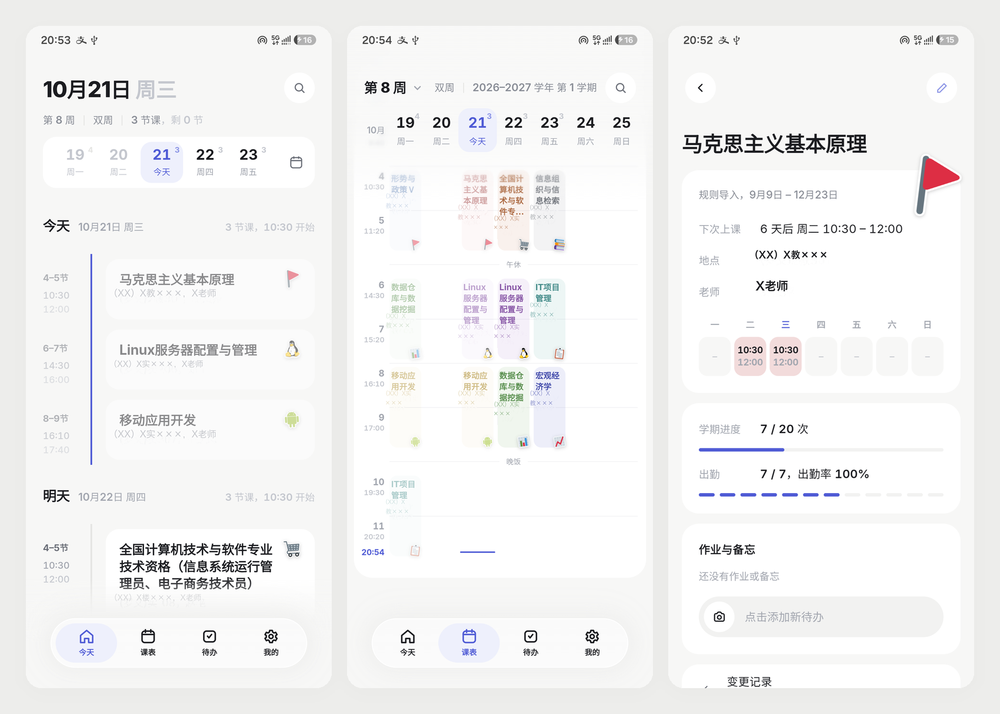
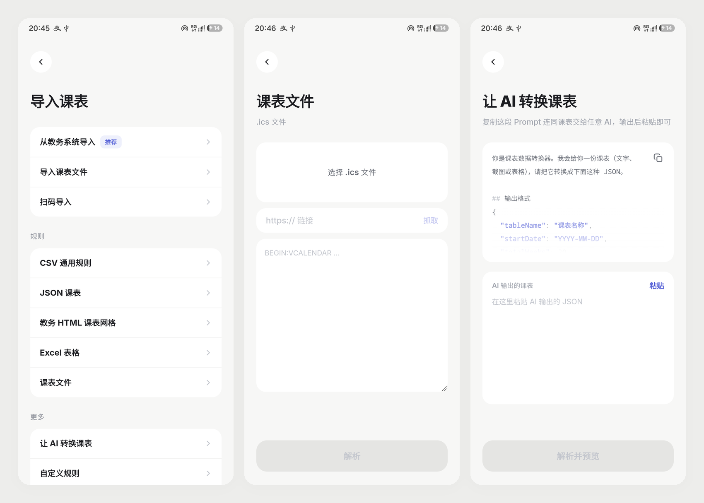
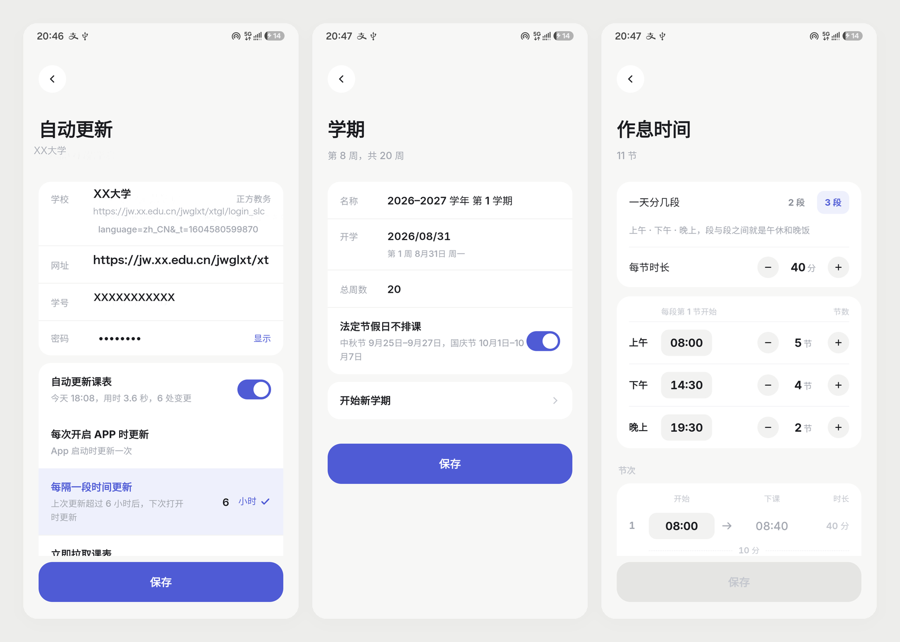
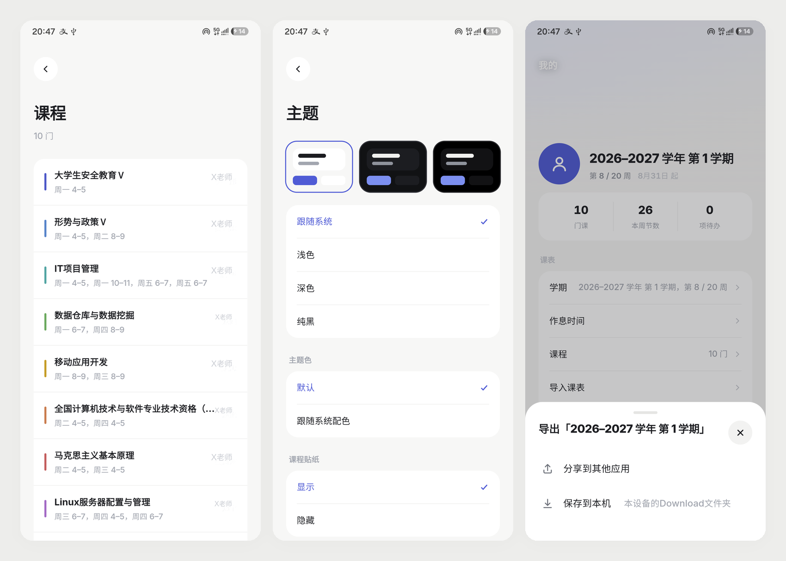
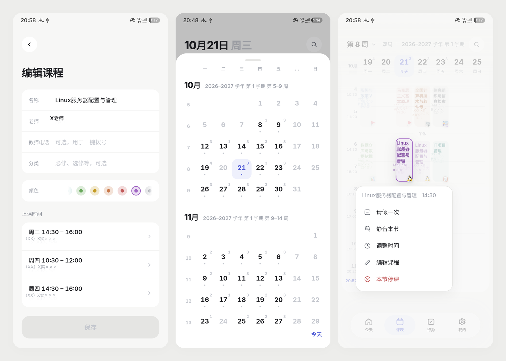

<div align="center">


<h1>嘎嘎课程表+</h1>

<p><strong>你的课表，理应如此。</strong></p>

<p>今天 / 周视图 / 多源导入 / 教务自动更新 / AI 转换 / 冲突处理 / 系统日历提醒 / 桌面小组件</p>

<p>
<a href="https://github.com/Tom13908/GagaTimetable-Alternative/releases/latest/download/GagaTimetable-Alternative-android.apk"></a>
</p>

<p><sub>Android 7.0+ · v0.1 · <a href="https://github.com/Tom13908/GagaTimetable-Alternative/releases">全部版本</a></sub></p>

</div>

## 相对上游的新特性

基于 [shuakami/timetable](https://github.com/shuakami/timetable) 1.4.78（GPL-3.0）分叉，主要新增：

- **教务自动更新**：独立的「我的 → 自动更新」页，更新时机可选（每次启动 / 每 N 小时）；正方教务支持账号密码原生直连登录，不依赖 WebView 会话，登录失败按原因分类提示
- **作息「分段」模型**：一天分 2 段或 3 段（上午／下午／晚上），每段各自设起始时刻与节数，段间就是午休与晚饭；能从已有课表反推分段，导入来的不规则作息也能编辑
- **提醒总开关**：课程、待办提醒各自一个开关，默认关闭；关掉的类别不写系统日历、也不申请日历权限
- **导出课表**：整学期 .ics 可走系统分享，或直接存进本机 Download（MediaStore，免存储权限）
- **数据容错**：坏数据单条丢弃，不再整份清空；解析失败先把原文备份，写失败不让页面崩
- **ICS 往返修复**：导入剥掉「（调课）（停课）（请假）」后缀、合并键加入地点、支持座机号，备份恢复不再多出「高等数学（调课）」这样的幽灵课
- **解析健壮性**：周次支持「第7周」写法；正方周次识别不了时报 error，不再无声漏课
- **「今天」页日期条**：滑动即换日，整学期虚拟化渲染；从底部浮岛改为标题下吸顶
- **「课表」页日期条**：搬到吸顶区并支持左右滑换周（三份并排、跟手），翻到第 6 节也看得到日期
- **周视图卡片**：同一周行高全表统一；地点贪心折行不再被截断；贴纸固定右下角，长课名不会钻进去
- **贴纸渲染**：拼合 + 光栅化成位图，整页从约 1.2 万 DOM 节点降到少量 ``
- **平板与横屏适配**：430 / 600 / 720 / 900 四档宽度，浮层按内容区而非窗口宽定位
- **冷启动首屏壳**：内联静态骨架先画完再收系统开屏，不等 React；xlsx 解析器按需加载，约 333 KB 移出冷启动路径
- **「我的」页与统计**：顶部三格改为「门课 / 本周节数 / 项待办」，每周节数按本周实际生效的规则统计；未设头像与背景时用主题色占位，不再回落到内置照片

## 截图

### 今天 / 周视图 / 课程详情



### 导入课表 / .ics 文件 / 让 AI 转换



### 自动更新 / 学期 / 作息时间



### 课程 / 主题 / 分享课表



### 编辑课程 / 月历面板 / 长按菜单



## 功能

**今天**

- 按节次排的当日时间线：上过的课淡出，上课中显示还剩多久，下一节一小时内有倒计时，再往下是明天、后天
- 刚下课会在时间线上插一张卡：「这节课有作业吗？」，拍板书或写两句，直接存成这门课的待办
- 日期条钉在标题下面，翻到哪儿都还在；左右滑换周，点某一格看那天，右上角滑出整学期月历
- 没课、周末、假期、暂未开课、学期结束各有对应的空状态与提示条

**课表**

- 七列周视图，日期条与网格逐列对齐；左右滑换周时两条一起滑、同一步长，第一周和最后一周到头回弹
- 正在上的课高亮，标题上标着第几周与单/双周；同一时段撞课按开始时间叠放并标出重叠门数
- 冲突可「都保留」或「只留一门」，停掉的那门随时能恢复；每次改动都留一条变更记录
- 长按课程卡：请假一次、静音本节、调整时间、查看冲突、编辑课程、本节停课

**课程**

- 详情页：下次上课、地点、老师（存了电话就能一键拨号）、一周分布、学期进度、出勤率与逐次记录、这门课的作业与备忘
- 编辑课程改名称、老师、教师电话、分类与颜色；改某一次课（状态、日期、地点、老师、备注）默认只作用于本次，也能切成每周生效，两处都能撤销

**导入**

- 从教务系统导入（推荐）、导入课表文件（.ics / .xlsx / .csv / .json）、扫码、手动添加
- 规则里内置几条现成的（CSV / JSON / 教务 HTML 表格 / Excel / 课表文件），也可以自己配置 CSV 字段映射、粘贴 HTML、粘一个课表链接直接抓，或者写脚本解析
- **让 AI 转换课表**：复制内置 Prompt，把课表文字或截图丢给任意 AI，回来的 JSON 粘进来即可，包在代码块围栏里也能识别
- 解析后先看预览：新增、调整、无法解析逐条列出，确认前不动现有数据
- 重复导入做三方合并，手动改过的字段不会被覆盖；文件带节次表时同步更新作息
- 导出：整学期存成 .ics 进本机 Download，或直接走系统分享

**自动更新**

- 两种频率：「每次开启 APP 时」或「每隔 N 小时」，冷启动与回到前台时按设置决定跑不跑，也可以随时「立即拉取课表」
- 正方教务内置直连登录，填学号密码即可，密码只留在本机；其它教务系统复用导入时留下的浏览器会话
- 拉回来的课表同样走三方合并，只提示真正变化的部分；连续三次会话失效会自动关掉开关，不再反复弹窗
- 「我的 → 自动更新」可改学校与账号、更新频率、查看上次结果、退出绑定（会连会话一起清掉）

**学期与作息**

- 开学日期自动落到所在周的周一，总周数可改；学期过完标成「已结束」，在「我的 → 学期」开始新学期，旧学期连课表封存进往期
- 学期内的法定节假日直接列出来，也可以关掉「节假日不排课」
- 作息按「一天分几段」铺开：2 段或 3 段，每段自己的起始时刻与节数；每节时长统一，单节下课能单独改，改坏了点「恢复」
- 段与段之间自动认成午休、晚饭；节次重叠或倒序会标红

**待办**

- 作业、考试、备忘三类，按今天 / 这周 / 以后 / 没有截止 / 已完成分组，可以挂在某门课上
- 拍照或只写文字都行；课程详情页里只看这门课的

**提醒与小组件**

- 提醒全部交给系统日历：每门课一本、沿用课程颜色，作业、考试、周次各一本；上课前、截止前、考试前由日历发出
- 停课、请假的那节保留在日历里（标题带说明、不提醒）；老师电话写进事件描述，点开就能拨
- 学期结束后课程日历自动从日历列表隐起，记录保留；你在系统日历里改的颜色不会被同步覆回
- 4 款桌面小组件：今日、下一节、两日、本周，跟随系统深浅色

**外观**

- 浅色 / 深色 / 纯黑三套主题，也可以跟随系统
- Android 12+ 可让主题色跟随壁纸取色（Material You），默认关
- 学科贴纸按课名自动匹配、逐门可改，不喜欢就整体隐藏

**Android**

- 确认框、Toast、剪贴板、触感反馈走原生通道，触感按轻重分级
- Android 13+ 主题图标（monochrome）、自适应开屏、边到边加安全区
- 返回键依次关闭菜单或面板、出栈、回到「今天」、两次返回退出

**数据**

- 课表、账号、导入历史全部存在本机（SQLite），不联网也能用，不上传任何服务器
- 「我的」里还有变更记录、导入历史、回收站与清除数据，删掉的课程能捞回来

## 技术栈

- 前端：React 18 + TypeScript + Vite 5 + Tailwind CSS v4 + motion
- 壳：Capacitor 8（minSdk 24 / targetSdk 36）
- 桌面小组件：Android 原生 RemoteViews（Java）
- 本地存储：SQLite（`@capacitor-community/sqlite`），Web 端用 sql.js + jeep-sqlite
- 自定义规则：用户脚本跑在 QuickJS（WASM）沙箱里，限时 2 秒、限内存 32 MB；.xlsx 用 SheetJS 解析

## 快速开始

```bash
# Node 22
npm ci
npm run dev            # http://localhost:5173，浏览器直接调试 Web 端
```

完整验证：

```bash
npm run check          # tsc --noEmit && vitest run && vite build
```

Android debug 包（需要 JDK 21；JDK 25 会让 AGP 8 直接报 class file 版本错误）：

```bash
export JAVA_HOME=$(/usr/libexec/java_home -v 21)   # Linux: /usr/lib/jvm/java-21-openjdk-amd64
npm run build && npx cap sync android
cd android && ./gradlew assembleDebug
# → android/app/build/outputs/apk/debug/app-debug.apk
```

Gradle 下载慢时在 `~/.gradle/init.gradle` 加国内镜像；更多打包与发版细节见 [AGENTS.md](AGENTS.md)。

## 许可

GPL-3.0

本项目基于 [shuakami/timetable](https://github.com/shuakami/timetable)（GPL-3.0）修改。

学校教务索引（`src/domain/edu/schools.json`）整理自 [baoozak/timetable](https://github.com/baoozak/timetable)（MIT）。
